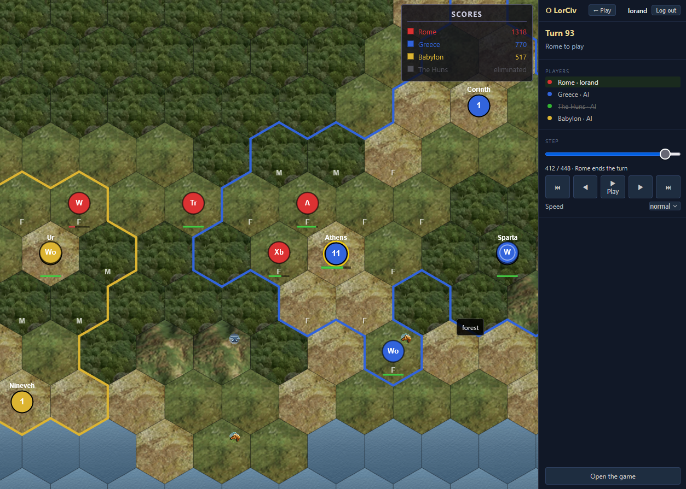

# LorCiv

A multiplayer web version of Civ Lite, a small turn-based 4X game on a hex map:
up to four seats per game, each a signed-in person or an AI played by the
server. Games may take minutes or days; a turn clock keeps them moving and an
absent player's seat is handed to the AI.

**Live:** https://lorciv.lorand77.dev



## Features

- Tables in the lobby: open a table, let people take seats, start when ready
- Turn-based play against people and AI, with the whole game on the server
- Turn timers from one minute to three days; missed turns hand the seat to the AI
- Games survive reloads and server restarts; nothing is lost
- Spectating, in-game chat, "your turn" notifications

## Stack

Node.js 24, Express 5, Socket.IO and SQLite (better-sqlite3) on the server;
vanilla JavaScript in the browser, with no framework and no build step. The
browser and the server load the same game engine (`src/shared/`), so the
server validates every action with the rules the client previews by.

## Getting started

```sh
npm ci
\npm rebuild better-sqlite3 argon2 --foreground-scripts --ignore-scripts=false
npm run dev    # http://localhost:3001
node --run test
```

The rebuild and the test command are what they are because of the Socket
wrapper used in development; see `docs/setup.md`.

## Docs

- [docs/design.md](docs/design.md): architecture and the reasons behind it
- [docs/plan.md](docs/plan.md): the milestones, done and ahead
- [docs/setup.md](docs/setup.md): running and deploying
- [docs/CLAUDE.md](docs/CLAUDE.md): conventions for working in the repo

## License

MIT, see [LICENSE](LICENSE). The `better-sqlite3-session-store` dependency is
GPL-3.0-only and is used as a dependency, never copied.
